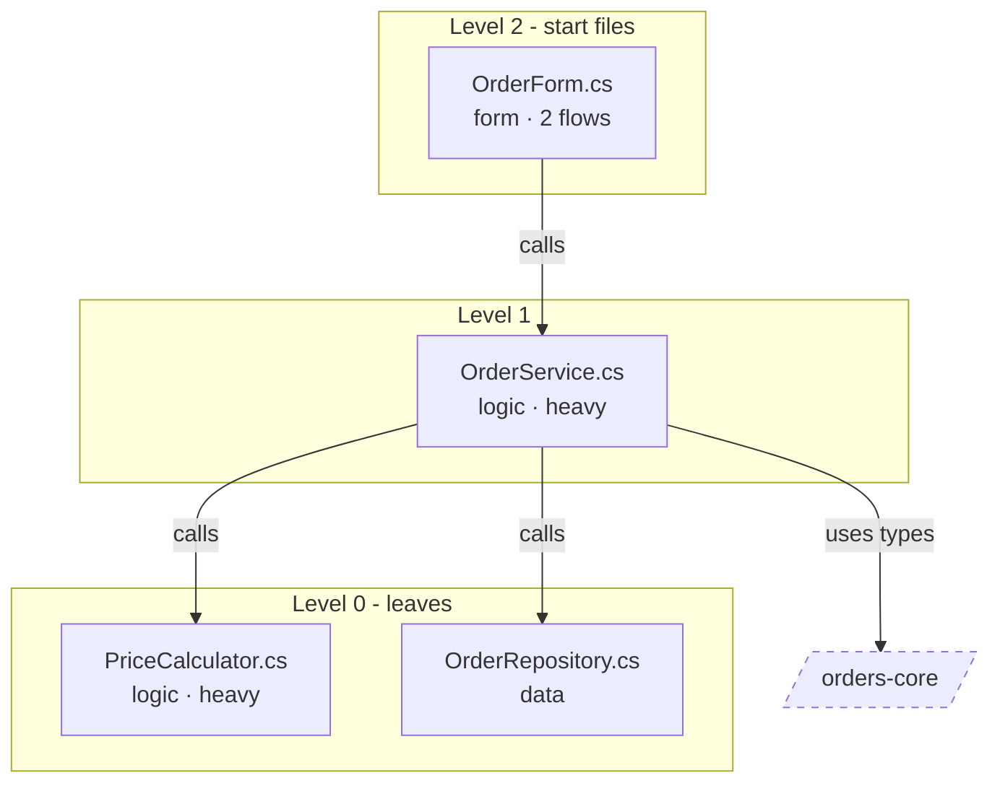

# Deep-dive formats

The plans `/mod-deepdive` writes in `docs/deepdive/`. The Scaffolder builds from them. IDs
are local to each file (`P3`, `R2`, `T7`, `B1`). Leave out a section or a row with nothing to
say. Every fact cites `path:line`.

## In the component file

Add § Deep-dives after § Suggested approach if it isn't there, with one line per plan
(`/mod-implement-port` later adds § In the modern solution after it):

```markdown
## Deep-dives

- [<the map and port plan | flow name>](../deepdive/<file>.md) · <files | flow | walk-through> · YYYY-MM-DD
```

## The map and the port plan: `docs/deepdive/<component>.md`

````markdown
# <component> — deep-dive

**Verdict:** <Port | Rewrite | Split | Keep> (target.md § 6) · **Mode:** <files | flows | both | not chosen> · **Target:** target.md, accepted YYYY-MM-DD · **Map:** <complete | partial> · **Updated:** YYYY-MM-DD

## Flows

| Flow | Trigger | Start file | Files (start → leaves) | Data and external calls | Plan |
|---|---|---|---|---|---|

**Flow road map:** —

## File map

<the file map diagram>

| Level | File | Role | Uses | Used by | Flows |
|---|---|---|---|---|---|

Level 0 uses no other file of this component (a leaf). Level n uses only lower levels. Files
that use each other share a level.

## Port plan

Leaf first. A step is done when its unit tests pass in `modern/`. The Scaffolder ports it
with `/mod-implement-port <component>`.

**Road map:** —

| Step | Legacy files | Modern files | Changes | Needs | Status |
|---|---|---|---|---|---|

### Unit tests

| Test | Member | Scenario | Given | Expect | From | Check |
|---|---|---|---|---|---|---|

## Open questions

- Q-### <the question in a few words>
````

- **Step:** `P0` (the new project and test project, when needed), then `P1`, `P2`…
- **Changes:** the blockers and their replacements, the project and namespace changes.
- **Needs:** earlier steps, other components (ported, or still referenced as they are), fakes.
- **Flow road map:** the order of the flows the developer accepted in `/mod-implement-flow`:
  `accepted YYYY-MM-DD · "<flow>" → "<flow>" (B1 → B3 → B2) → … · later: <flows, or —>`,
  set by the Guide.
- **§ Screens:** added after § Port plan (or § File map) when the developer accepts a road
  map in `/mod-implement-ui`; its format is in
  [/mod-implement-ui § What the Guide records](../mod-implement-ui/SKILL.md#what-the-guide-records).
- **Road map:** the order of the steps the developer accepted in `/mod-implement-port`:
  `accepted YYYY-MM-DD · P1 → P2 → P4 → … · later: <steps, or —>`, set by the Guide.
- **Status:** `to do` · `done (YYYY-MM-DD)` · `partial (YYYY-MM-DD): <what's left>
  (Q-###)`, set by the Guide from the Scaffolder's accepted records.
- **Test:** the step and a number (`P3.2`). **Scenario:** happy · boundary · negative · error.
- **Expect:** what the legacy code does. **From:** where that's coded.
- **Check:** `code` (read from the code) · `run legacy` (rounding, dates, money or data:
  confirm on a legacy run before trusting it).

## A flow or a walk-through: `docs/deepdive/<component>--<flow>.md`

A walk-through (`/mod-deepdive <component> <screen | file | class.method | "feature">`) has
the first two sections; planning it as a flow adds the rest.

````markdown
# <flow name> — <component>

**Trigger:** <who or what starts it> · **Start:** `path:line` · **Components:** <the ones it crosses> · **Verdict:** <from target.md § 6> · **Updated:** YYYY-MM-DD

## Walk-through

<In plain words: how it's triggered, the path through the code (handler → logic → data)
with path:line, the data read and written, external calls, the messages shown.>

<the sequence diagram>

## Logic map

<the logic map diagram>

| Rule | In business words | Type | Where (every copy) | Exact details | Copies agree | Confirmed |
|---|---|---|---|---|---|---|

## Design (SDD)

**What it does for the business:** <2–4 sentences> · **Actors:** <roles, systems, schedules>

**S1** As a <role>, I want <what>, so that <why>.
- Given <…>, when <…>, then <…> (R1, T1)

| Field or control | Data | Validation | Default | Messages |
|---|---|---|---|---|

| In / out | Data | From / to | Format |
|---|---|---|---|

**On the target:** <the modern files, classes and endpoints, per target.md § 3–5; how it runs side
by side with legacy until it's live>

**Out of scope:** <what this plan leaves out>

## Tests (TDD)

Technology-neutral. Expected values come from the legacy behaviour, never from the new code.

| Test | Rule | Scenario | Given | When | Then | From | Check |
|---|---|---|---|---|---|---|---|

**Fakes:** <database, files and shares, clock, user, culture, external calls: what replaces
each one in tests>

**Pitfalls:** <rounding mode, decimal or floating point, integer division, dates and time
zones, culture and number formats, null or empty, ordering, collation>

## Build steps

Tests first: each step writes its tests, then the code that makes them pass. The Scaffolder
builds them with `/mod-implement-flow <component> "<flow>"`.

| Step | What to build (in `modern/`) | Tests | Needs | Status |
|---|---|---|---|---|

## Open questions

- Q-### <the question in a few words>
````

- **Rule type:** validation · calculation · decision · workflow · data · format.
- **Exact details:** constants, formats, rounding, messages, as coded.
- **Copies agree:** `yes` · `no: <how they differ>` (and a question) · `—` (one copy).
- **Confirmed:** `—`, or the business person and the date.
- **Stories:** each criterion names the rules and tests it covers.
- **Test scenario, From, Check, Status:** as in the port plan.

## Diagrams

Follow the rules in
[../mod-legacy-report/diagrams.md](../mod-legacy-report/diagrams.md#rules-for-every-diagram).
The walk-through uses its [Flow recipe](../mod-legacy-report/diagrams.md#flow). The examples
here are only examples.

**File map:** one subgraph per level, start files on top, leaves at the bottom. Arrows point
to the file used. Other components are `outside` nodes.



**Logic map:** the flow's steps top to bottom. A decision is a diamond that names its rule;
data is a cylinder; the start and the end are rounded.


