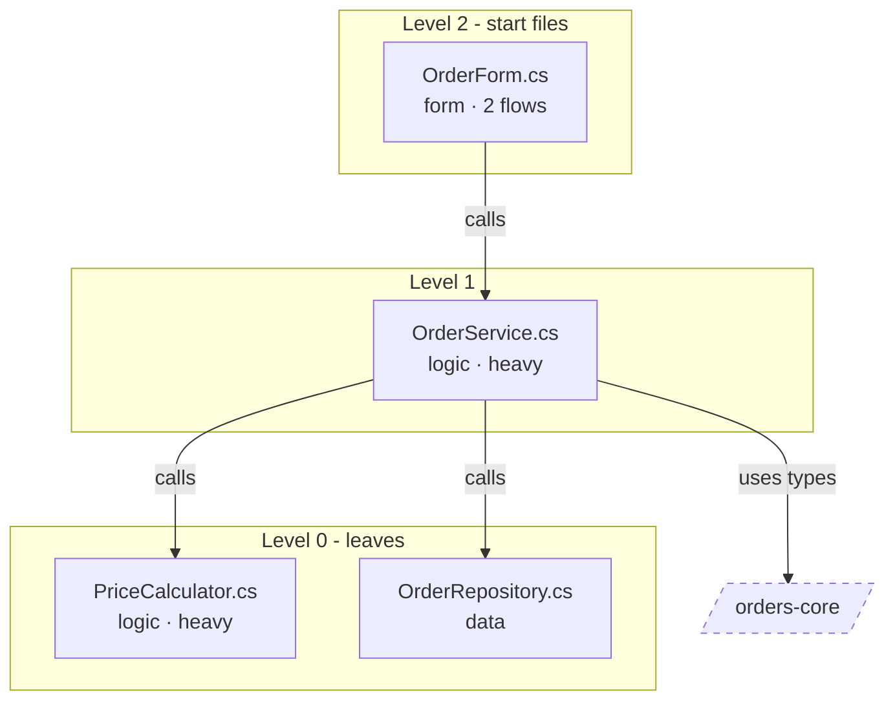
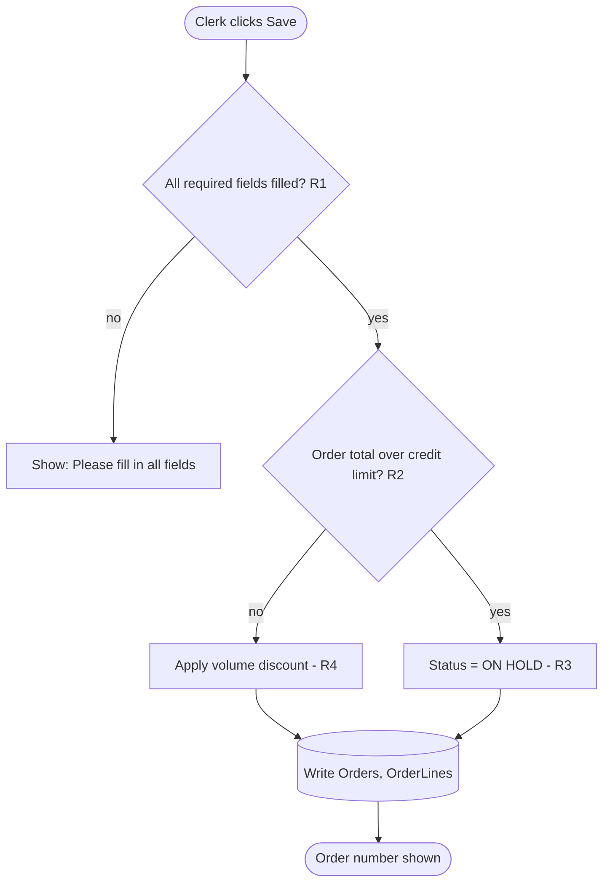

# Deep-dive formats

What `/mod-deepdive` writes in a component's folder, `docs/components/<component>/`. The
Scaffolder builds from it with `/mod-implement <component>`. IDs are local to each file (`R2`,
`T7`, `B1`, `U1`); outside its own files, a flow's or a screen's IDs carry its number
(`F02-R2`, `S01-U1`). Port steps (`P3`) and their tests (`P3.2`) are unique already. Leave out a
section or a row with nothing to say. Every fact cites `path:line`.

## Statuses

Set by the Guide from the Scaffolder's accepted build records:
- **A step** (a port step, a flow's build step, a screen's step): `to do` ·
  `done (YYYY-MM-DD)` · `partial (YYYY-MM-DD): <what's left> (Q-###)`, then, when it happens,
  `· reworked (YYYY-MM-DD): <what>` · `· fixed (YYYY-MM-DD): <what>` ·
  `to do · reverted (YYYY-MM-DD)` · `· re-check (YYYY-MM-DD): Q-### answered` (set by
  `/mod-answer`; it stays until a rework or fix of the step is recorded).
- **An item** in the order of work: `to do` · `building (<k> of <n> steps)` ·
  `done (YYYY-MM-DD)` · `partial: Q-###`.
- **A plan file** (`logic.md`, `sdd.md`, `tdd.md`, a screen plan): `in progress` ·
  `complete` · `complete, resting on Q-###`.

## In `component.md`

Add § Deep-dives after § Suggested approach if it isn't there (`/mod-implement` later adds
§ In the modern solution after it):

```markdown
## Deep-dives

- [Map, plan and order of work](deepdive.md) · plan <accepted YYYY-MM-DD | not accepted> · YYYY-MM-DD
- [Port steps](port.md) · <k> of <n> done
- [F01 · <flow>](flows/01-<flow>/logic.md) · logic <✓ | in progress | —> · sdd <✓ | —> · tdd <✓ | —>
- [S01 · <screen>](screens/01-<screen>.md) · <✓ | in progress>
```

## The map and the plan: `deepdive.md`

````markdown
# <component> — deep-dive

**Verdict:** <Port | Rewrite | Split | Keep> (target.md § 6) · **Plan:** <accepted YYYY-MM-DD | not accepted> · **Target:** target.md, accepted YYYY-MM-DD · **Map:** <complete | partial> · **Updated:** YYYY-MM-DD

## Flows

Numbered in the order of work; a number never changes.

| # | Flow | Trigger | Start file | Files (start → leaves) | Data and external calls | Plan |
|---|---|---|---|---|---|---|
| F01 | [<flow>](flows/01-<flow>/logic.md) | | | | | logic ✓ · sdd ✓ · tdd — |

## File map

<the file map diagram>

| Level | File | Role | Uses | Used by | Flows |
|---|---|---|---|---|---|

Level 0 uses no other file of this component (a leaf). Level n uses only lower levels. Files
that use each other share a level.

## How each file moves

| File | Level | Moves by | Into (modern project) | Plan | Why |
|---|---|---|---|---|---|

## Order of work

| # | Item | Kind | What | Needs | Plan | Status |
|---|---|---|---|---|---|---|
| 1 | P1 | port | `PriceCalculator.cs` | — | [port.md](port.md) | to do |
| 2 | F01 | flow | Save an order | P1–P4 | [tdd](flows/01-save-an-order/tdd.md) | to do |
| 3 | S01 | screen | Main window (shell) | — | [plan](screens/01-main-window.md) | to do |

## Open questions

- Q-### <the question in a few words>
````

- **Plan (in § Flows):** the state of the flow's files: `✓` (complete), `in progress` or `—`;
  `walk-through` when it has only `logic.md`; `ported: P2–P5` when its whole path is ported.
- **Moves by:** port · rebuild · screen · regenerate · keep. **Plan:** the step or item that
  moves it (`P3`, `F01`, `S02`).
- **Kind:** port · flow · screen. A flow or screen is one item; its steps run in their own
  order. **Needs:** the items that must be done first.
- **Plan (in § Order of work):** a link to the item's plan, or `to write` while it's still
  being planned.

## The port steps: `port.md`

````markdown
# <component> — port steps

**Status:** <in progress | complete> · <k> of <n> steps done · **Updated:** YYYY-MM-DD

Leaf first. A step is done when its unit tests pass in `modern/`.

| Step | Legacy files | Modern files | Changes | Behaviour risks | Needs | Status |
|---|---|---|---|---|---|---|

## Unit tests

| Test | Member | Scenario | Given | Expect | From | Check |
|---|---|---|---|---|---|---|

## Open questions

- Q-### <the question in a few words>
````

- **Step:** `P0` (the new project and test project, when needed), then `P1`, `P2`…
- **Changes:** the blockers and their replacements, the project and namespace changes.
- **Behaviour risks:** the changes and runtime differences that could change behaviour
  ([runtime-differences.md](runtime-differences.md)), each with its test.
- **Needs:** earlier steps, other components (ported, or still referenced as they are), fakes.
- **Test:** the step and a number (`P3.2`). **Scenario:** happy · boundary · negative ·
  error · risk.
- **Expect:** what the legacy code does. **From:** where that's coded.
- **Check:** `code` (worked out from the code) · `run legacy` (rounding, dates, money, data or
  the runtime: confirm on a legacy run before trusting it).

## A rebuilt flow: `flows/<nn>-<flow>/`

Three files, written in this order. Each starts with the same header line, and links to the
other two. A walk-through has `logic.md` only, until it's planned as a flow.

### `logic.md`

````markdown
# F<nn> · <flow name> — logic

**Component:** <component> · **Trigger:** <who or what starts it> · **Start:** `path:line` · **Crosses:** <the components it reaches> · **Status:** <in progress (<m> of <M> methods) | complete> · **Updated:** YYYY-MM-DD

logic · [sdd](sdd.md) · [tdd](tdd.md)

**Coverage:** <m> of <M> methods read · <b> of <B> branches accounted for · <r> rules, <c> checked

## Walk-through

<In plain words: how it's triggered, the path through the code (handler → logic → data)
with path:line, the data read and written, external calls, the messages shown.>

<the sequence diagram>

## Coverage ledger

| Method | Where | Branches | Rules | Read |
|---|---|---|---|---|

## Logic map

<the logic map diagram>

| Rule | In business words | Type | Where (every copy) | Exact details | Copies agree | Moves | Checked | Confirmed |
|---|---|---|---|---|---|---|---|---|

## Traps

| Trap | Where | What legacy does |
|---|---|---|

## Open questions

- Q-### <the question in a few words>
````

- **Branches:** how many, and which are `technical` and why. **Read:** `✓`, or the `Q-###`
  that says why it couldn't be read.
- **Rule type:** validation · calculation · decision · workflow · data · format.
- **Exact details:** constants, formats, rounding mode, messages word for word, the order the
  validations run in.
- **Copies agree:** `yes` · `no: <how they differ>` (and a question) · `—` (one copy).
- **Moves:** `rebuilt`, or `port P3` when it's coded in a ported file.
- **Checked:** `✓` when the independent check confirmed it against its lines.
- **Confirmed:** `—`, or the business person and the date.

### `sdd.md`

````markdown
# F<nn> · <flow name> — design (SDD)

**Component:** <component> · **Status:** <in progress | complete> · **Updated:** YYYY-MM-DD

[logic](logic.md) · sdd · [tdd](tdd.md)

**What it does for the business:** <2–4 sentences> · **Actors:** <roles, systems, schedules>

## Stories

**S1** As a <role>, I want <what>, so that <why>.
- Given <…>, when <…>, then <…> (R1, R2)

## Screen behaviour

| Field or control | Data | Validation | Default | Messages (word for word) |
|---|---|---|---|---|

## Data and integrations

| In / out | Data (table and column, or message) | From / to | Format |
|---|---|---|---|

**Side effects, in order:** <1. …, 2. …>

## Behaviour parity

| Must stay identical | Rules |
|---|---|

| May differ | How | Source (target.md § 5 or a decision) |
|---|---|---|

## On the target

<the modern files, classes and endpoints, per target.md § 3–5; the ported code it calls; how it
runs side by side with legacy until it's live>

**Out of scope:** <what this plan leaves out>

## Open questions

- Q-### <the question in a few words>
````

### `tdd.md`

````markdown
# F<nn> · <flow name> — tests (TDD) and build steps

**Component:** <component> · **Status:** <in progress | complete> · **Updated:** YYYY-MM-DD

[logic](logic.md) · [sdd](sdd.md) · tdd

**Coverage:** <r> of <R> rebuilt rules and <b> of <B> branches have a test · ported rules: <P3.2, P4.1…> · <t> tests in build steps

## Tests

Technology-neutral. Expected values are worked out from the legacy lines, never from new code.

| Test | Rule | Scenario | Given | When | Then | Worked out from | Check |
|---|---|---|---|---|---|---|---|

## Golden examples

Run these on legacy and record the output; it becomes the expected value.

| Test | Inputs | Legacy output (recorded by, date) |
|---|---|---|

**Fakes:** <database, files and shares, clock, user, culture, external calls: what replaces
each one in tests>

**Pitfalls:** <the traps from logic.md to watch in the new code>

## Build steps

Tests first: each step writes its tests, then the code that makes them pass.

| Step | What to build (in `modern/`) | Tests | Needs | Status |
|---|---|---|---|---|

## Open questions

- Q-### <the question in a few words>
````

- **Test scenario:** happy · boundary · negative · error · trap · side effect · end to end.
- **Worked out from:** the cited lines, and for a calculation the steps
  (`100 × 0.15 = 15.00; Math.Round to even → 15.00`).
- **Check, Status:** as in `port.md` and § Statuses.

## A screen: `screens/<nn>-<screen>.md`

````markdown
# S<nn> · <screen name> — screen plan

**Component:** <component> · **Legacy:** `<layout file>`, `<code-behind>` · **Kind:** <main window or menu | list | detail or edit | dialog or lookup | report or print> · **Opens · opened from:** <…> · **Flows it starts:** <F01, F03> · **Status:** <in progress | complete> · **Updated:** YYYY-MM-DD

## Inventory

| Control | Label | Data | Format | Default | Read-only, hidden, disabled when | Validation | Tab |
|---|---|---|---|---|---|---|---|

| Event | What it does | Where |
|---|---|---|

**Data:** <loaded from, saved to> · **Navigation:** <in, out, what it returns>

**Messages (word for word):** <…>

## The split

| Legacy code (`path:line`) | What it does | Goes to | Built by |
|---|---|---|---|

## Steps

| Step | What to build (in `modern/`) | Tests | Needs | Status |
|---|---|---|---|---|

## Side-by-side check

- <what to compare with the legacy screen open next to the new one>

## Open questions

- Q-### <the question in a few words>
````

- **Goes to:** UI · UI and backend · backend: business · backend: data · backend:
  integration.
- **Built by:** for the UI, this screen's `U` step; for the backend, a port step (`P3`), a
  flow's build step (`F01-B2`), or this screen's `B` step.
- **Step:** `B1`… for the backend pieces this screen builds itself, then `U1`… for the screen
  (one per tab or section when it has more than about 30 controls).

## Diagrams

Follow the rules in
[../mod-legacy-report/diagrams.md](../mod-legacy-report/diagrams.md#rules-for-every-diagram).
The walk-through uses its [Flow recipe](../mod-legacy-report/diagrams.md#flow). The examples
here are only examples.

**File map:** one subgraph per level, start files on top, leaves at the bottom. Arrows point
to the file used. Other components are `outside` nodes.



**Logic map:** the flow's steps top to bottom. A decision is a diamond that names its rule;
data is a cylinder; the start and the end are rounded.


