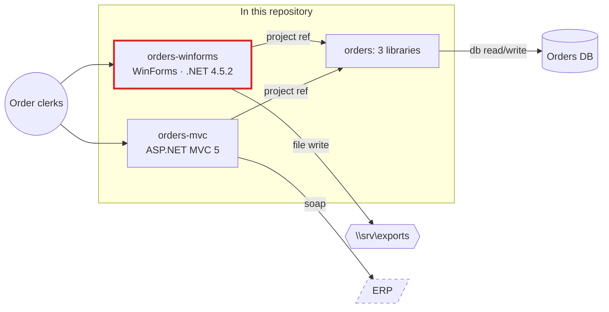
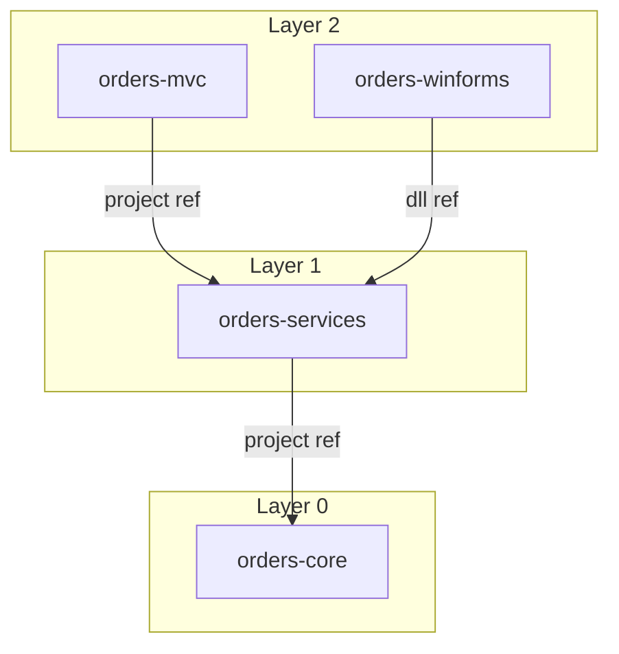
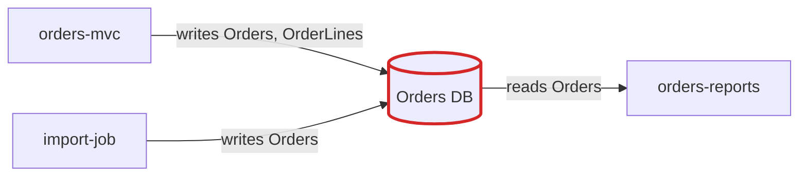
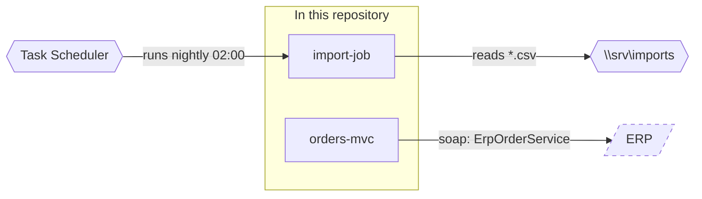
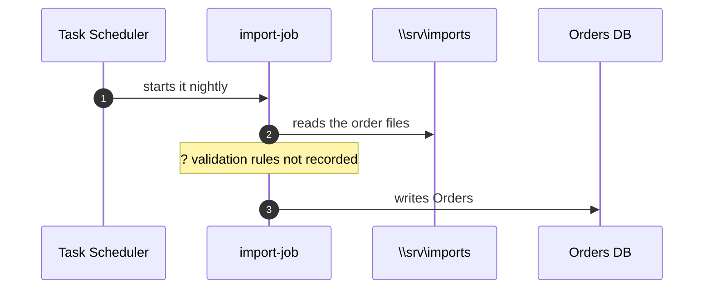
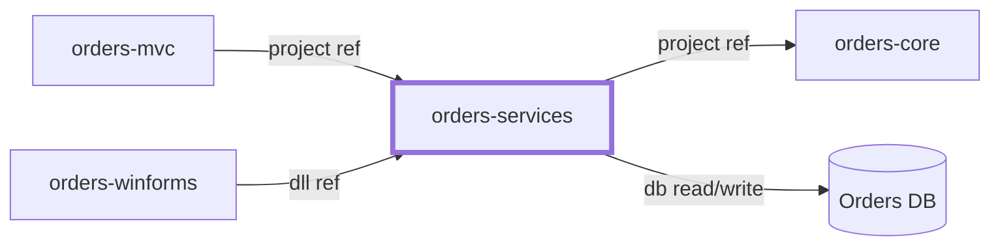
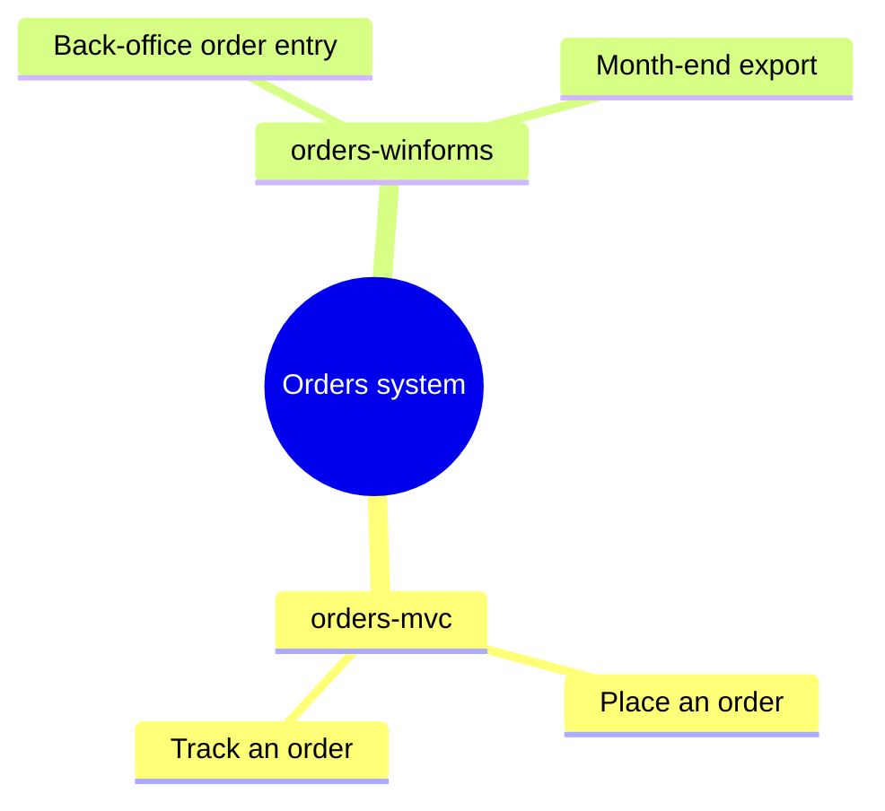
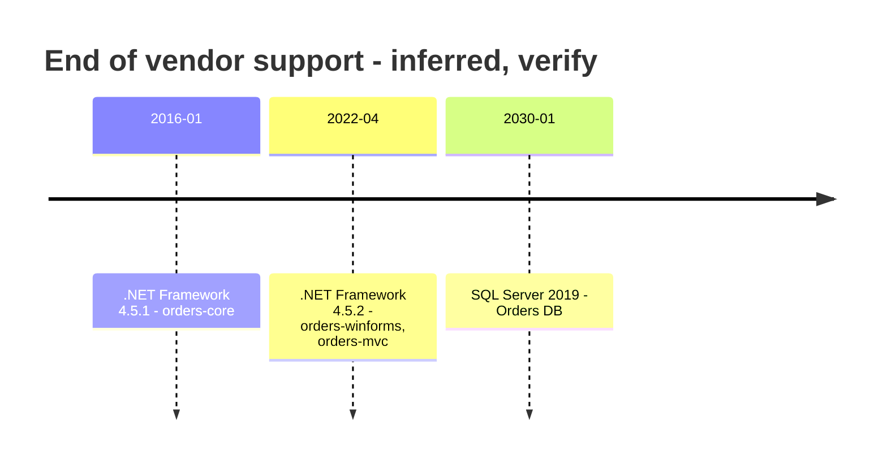

# Diagrams for /mod-legacy-report

Mermaid, rendered by the Markdown preview (`bierner.markdown-mermaid`). One recipe per
picture. Use the recorded names; the examples are only examples.

## Rules for every diagram

- **A caption line above it:** what the arrows mean and what the styles mark.
- **Node IDs:** the component slug with `-` changed to `_` (`orders_mvc`), letters, digits
  and `_` only. Never use `end`, `graph`, `subgraph`, `class`, `style`, `click` or `default`
  as an ID: add `_n`.
- **Flowchart labels:** always in double quotes, with no `"` or `;` inside. Use `<br/>` for a second
  line, such as the technology: `orders_mvc["orders-mvc<br/>ASP.NET MVC 5"]`.
- **Shapes,** as in `system.md`:

  | Thing | Shape |
  |---|---|
  | component | `id["name"]` |
  | database | `id[("name")]` |
  | other resource (share, queue, config, scheduler…) | `id{{"name"}}` |
  | external system | `id[/"name"/]`, with class `outside` |
  | people (actors) | `id(("name"))` |

- **Arrows:** `a -->|"mechanism"| b`, from the one that depends or acts to what it depends
  on or acts on. Only the data diagram follows the data instead.
- **Styles:** strokes only, so they read in light and dark themes. Add the `classDef` lines
  a diagram uses:

  ```text
  classDef risk stroke:#d62728,stroke-width:3px
  classDef outside stroke-dasharray:5 5
  classDef focus stroke-width:4px
  ```

  `risk`: out of support, in a cycle, or a shared write. `outside`: outside the repository.
  `focus`: the subject of a profile.
- **Size:** at most about 25 nodes. For more, draw one overview with a node per solution or
  layer (`"billing: 7 components"`), then one diagram per group.
- **Check before you write:** the first line names the diagram type; every arrow joins
  declared IDs; no ID is declared twice.

## Context

The repository as a boundary: the apps and services in it, and the people, external
systems, databases and shares around it. Collapse libraries into one node per solution.



## Layers

Components only, one subgraph per layer, highest layer on top. Arrows point down to what a
component depends on. Mark cycle members `risk`.



## Data

Writers on the left, stores in the middle, readers on the right. Arrows follow the data, and
labels name the tables when they're recorded. Mark a store written by 2 or more components
`risk`.



## Integrations

Like the context diagram, but every mechanism that crosses the boundary or a resource:
services, queues, shares, schedules and CLI launches. Label each arrow with its detail
(endpoint key, queue name, path, schedule).



## Flow

A sequence diagram, trigger first, one participant per component or resource. Steps the
records don't show are notes starting with `?`.



## Neighbourhood

One component (`focus`), what uses it on the left, what it depends on and its resources on
the right. One hop each way.



## Features

A mindmap of capabilities per component. Plain words only: no brackets or parentheses in
the text, because a mindmap reads them as shapes.



## Support timeline

The end-of-support dates you know, oldest first, with the components affected. No `:`
inside the text.


