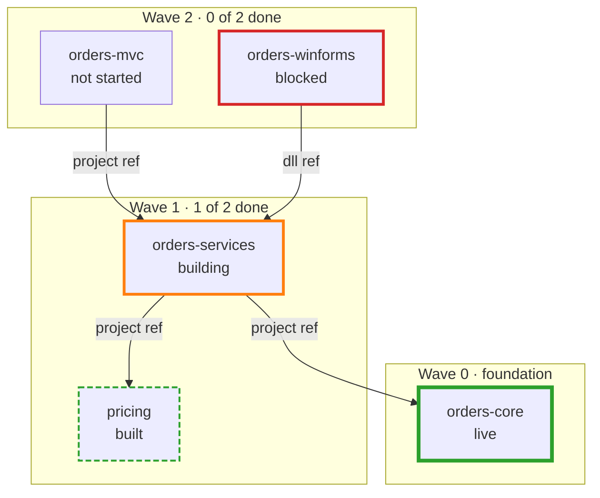
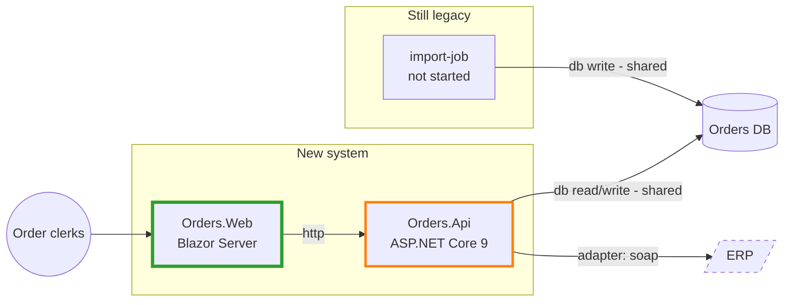
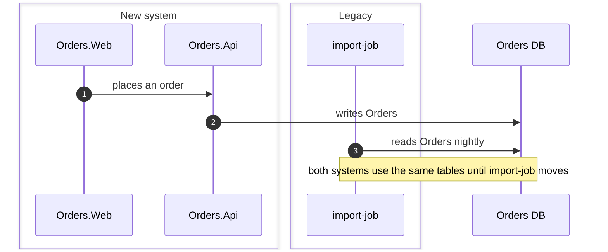
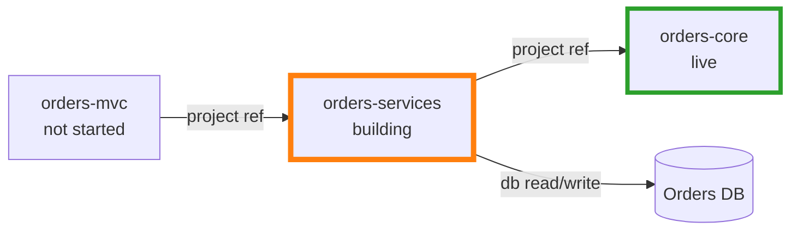
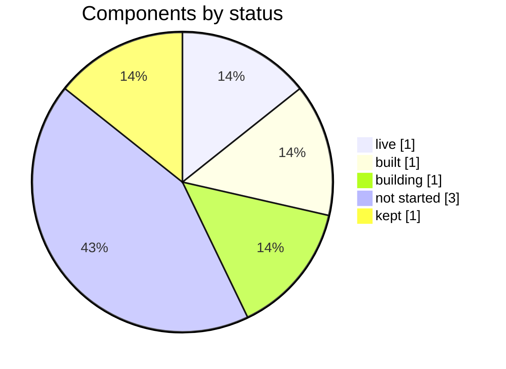
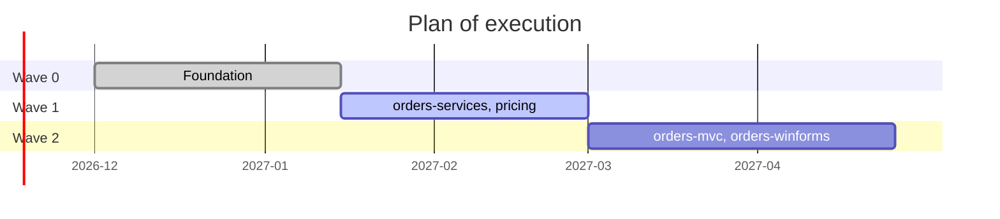

# Diagrams for /mod-modern-report

The rules for every diagram (IDs, labels, shapes, arrows, size, the check before you write)
are in [../mod-legacy-report/diagrams.md](../mod-legacy-report/diagrams.md#rules-for-every-diagram).
These recipes add the migration status. The examples are only examples.

## Status styles

Put the status in the label as well, so a diagram reads without colour:
`orders_core["orders-core<br/>built"]:::built`. Not started has no class.

```text
classDef live stroke:#2ca02c,stroke-width:4px
classDef built stroke:#2ca02c,stroke-width:2px,stroke-dasharray:6 3
classDef building stroke:#ff7f0e,stroke-width:3px
classDef kept stroke:#7f7f7f,stroke-dasharray:2 2
classDef blocked stroke:#d62728,stroke-width:3px
```

`blocked` replaces the not-started look for a component that can't start yet.

## Migration map

The legacy components, one subgraph per wave with its progress in the title, coloured by
status. Arrows point to what a component depends on.



## Target architecture

The new system in `modern/`, the legacy parts it still relies on, and the bridges between
them. Arrows point from the one that calls or depends to what it reaches.



## Coexistence

A sequence diagram for one flow, with a `box` for the new system and one for legacy, trigger
first. Steps the records don't show are notes starting with `?`.



## Neighbourhood

One component (`focus`) with what uses it and what it depends on, one hop each way,
coloured by status.



## Status pie

Components by status, kept ones included as their own slice.



## Waves over time

Only when the waves have dates. `done` and `active` follow the waves' progress.


