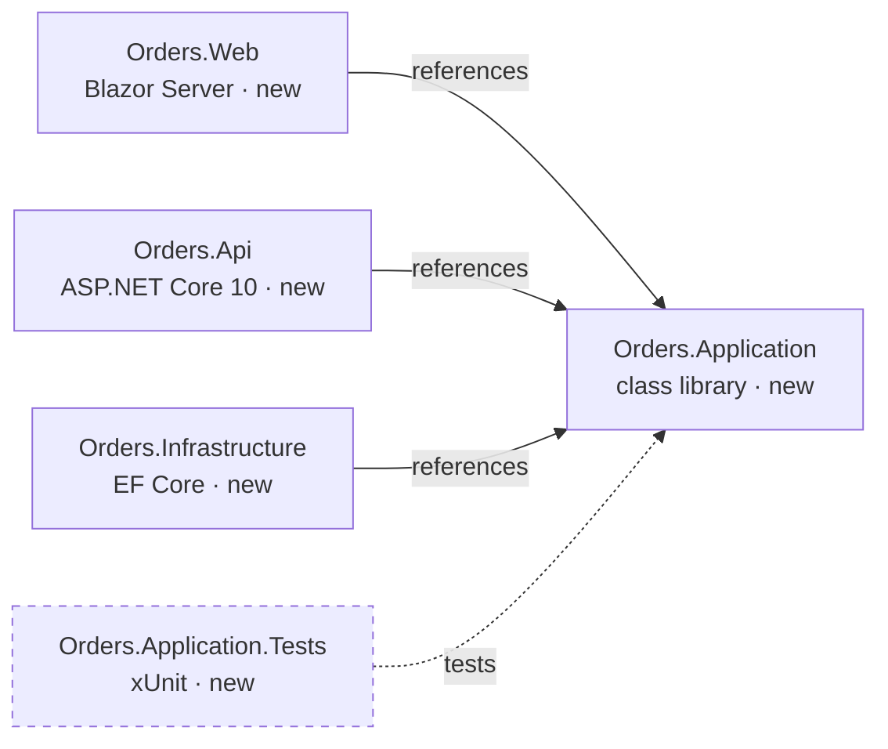

# /mod-target — Target stack and feasibility plan

**Requires agent: `Guide`.** Under another agent, stop and ask the developer to switch.

The developer chooses the target; you never choose it and never default to a stack you
prefer. You turn their choice into a precise plan they can read in one go, and they accept it
or ask for a change. `/mod-deepdive` needs it accepted.

Values in `<ANGLE BRACKETS>` come from the text after the command.

- **`docs/target.md` is NOT STARTED:** the text is the target stack ("Blazor Server + ASP.NET
  Core 10 API + EF Core + SQL Server"). Nothing given → ask for it (§ 2).
- **It is DRAFT or ACCEPTED:** the text is a change request (§ 7). Nothing given → the step
  still open: a DRAFT plan → § 5; a solution not accepted yet → § 6; both accepted → the
  plan's summary and the next-step options (§ 6).

**Gate:** every component has Technology ✓ and Dependencies ✓ in `docs/system.md § Discovery
progress`. If not, say "Discovery isn't complete: run `/mod-discover`" and stop. Components
without a deep pass (`/mod-discover-comp`) are still planned, marked "discovery only".

## 1. Read

- `docs/system.md`, all of it, and `docs/modern.md`.
- Every component file: § Technology, § Modernization signals, § Files and § Suggested
  approach. With more than about 15 components, search across `docs/components/` for those
  rows instead of opening every file.
- The OPEN questions in `docs/questions.md`.
- `docs/target.md`, to keep its sections and table columns.
- [deep-signals.md](../mod-discover-comp/deep-signals.md) § 1 (platform) and § 2 (port
  blockers).

## 2. Ask only the stack questions you need

1. Map the developer's stack text onto the layers the legacy system has: UI (desktop or web),
   API and services, business logic, data access, database, batch and jobs, messaging, files
   and shares, reports, identity. Add hosting, build and deploy, and testing.
2. For each layer with no clear choice in the text, ask with `askQuestions` (header "Target",
   at most 4 questions per call):
   - 2–4 realistic options that fit the rest of the stack, each with a one-line reason and its
     main risk;
   - `keep` (the legacy one stays) or `retire` where they apply, and "Don't know";
   - no ★ and no default: you never pick. A goal the developer stated may be named as the
     reason for an option, nothing more.
3. Without the tool, number the options and stop until the developer replies.
4. "Don't know" → the layer is `undecided` in § 2 of the plan, with a question (§ Unknowns
   become questions). It never blocks the plan.

Ask nothing else. Goals, constraints and port decisions are proposed in the draft, from the
context, and the developer changes them at review (§ 5).

## 3. Check what the records don't cover

For components without a deep pass, one Scout sweep (at most 3 briefs in parallel) over their
paths:
- LOOK FOR: deep-signals.md § 2 port blockers for this target, and § 1 Platform and
  environment;
- RETURN: `component | blocker or capability | detail | path:line`.

Check the chosen versions are supported and work together (for .NET, say LTS or STS).

## 4. Write the plan

Write `docs/target.md` with Status DRAFT, keeping its sections and columns:

1. **Goals and constraints:** 4–8 rows: why modernize, what must not change (data,
   integrations, user experience), hosting, coexistence, standards and licensing, deadlines.
   Source: the developer, a record (`path`), or "assumed (Q-###)".
2. **Legacy to target, per layer:** the legacy technology and version with the components
   using it, the target and version, and notes (support status, compatibility). Every legacy
   layer gets a target, `keep`, `retire` or `undecided`.
3. **Construct mapping:** only constructs the records show (§ Files roles, § Technology,
   signals): form or window, event handler, data-access class, stored procedure, report,
   scheduled job, file drop, service contract, config, shared library, VBA module… Give where
   each is found (components, file counts).
4. **Target structure (the modern solution):** the `modern/` tree down to each project's top
   folders; the projects table (name · kind · framework · references · the legacy
   components it receives · its test project), so every component lands somewhere or
   says why not; then conventions (naming, namespaces, folders, nullable, analyzers),
   test frameworks, and the generator commands in order. At most about 40 lines. This is
   what the Scaffolder builds, and the P0 step of every port plan. It's accepted on its
   own, right after the plan (§ 6).
5. **Port decisions:** the cross-cutting choices, each proposed with a reason: behaviour parity
   first or improve while porting; data schema unchanged or migrated; language (VB.NET kept
   or converted); data access (EF6 kept or EF Core); configuration and logging; package
   replacements; suspected defects kept and flagged; how old and new run side by side.
6. **Components: verdict and complexity:** one row per component (above about 40, group them
   by verdict and kind, and list every High one):
   - **Suggested:** from `/mod-discover-comp`, or "discovery only";
   - **Verdict** for this target: Port · Rewrite · Split · Keep, the same words as the
     suggestion. Say why when it differs. `Retire` only when the developer says so;
   - **Complexity:** count the drivers that are high:
     - size: over about 100 files or 20,000 lines;
     - logic: 5 or more `heavy` files, or rules in several places;
     - coupling: used by 3 or more components, or in a cycle;
     - gap: a Rewrite, or a blocker or capability gap with no option yet;
     - safety: no tests, or an H-risk question on it.

     0–1 high → Low · 2–3 → Medium · 4–5 → High. Drivers lists the high ones; a driver the
     records can't tell is `?`;
   - **Blockers and gaps:** the port blockers with their replacements, and the capability gaps.
7. **Capability gaps:** what legacy does that the target can't do the same way: local
   printing, shares and mapped drives, launching executables, COM and Office, registry,
   Windows identity and impersonation, 32-bit native DLLs, devices, MSMQ, distributed
   transactions, desktop APIs in a web target. Each has who needs it (evidence), why the
   target lacks it, 2–3 options, and the decision or its question.
8. **Open questions this plan rests on:** H first, one line each, at most 8.

**At most 150 lines.** Count them before writing. Over → shorten the notes and group rows;
never drop a layer, a High component or a gap. Precise over complete: facts, versions,
counts and evidence, no padding.

Then `docs/questions.md`: the new questions.

## 5. Accept or change

In chat (at most 15 lines): the link to `docs/target.md`, the stack in one line per layer,
the verdicts and complexity counts, the top 3 gaps, and the H-risk questions. Then ask with
`askQuestions` (header "Plan"):

- **Accept the plan**
- **Change something** (the developer says what)

Without the tool, ask "Reply `accept`, or say what to change", and stop.

**On accept:**
- `docs/target.md`: Status ACCEPTED, with the date;
- `docs/modern.md § Target and decisions`: one row per layer (Area · the target · "see
  target.md" · date), and one row "Target plan accepted: target.md";
- the OPEN questions the accepted target settles: ANSWERED, source "target.md, accepted
  YYYY-MM-DD";
- then § 6.

## 6. The modern solution, then the next step

Right after the plan is accepted, show the developer the solution the Scaffolder will build,
from § 4 of the plan, and what `modern/` already holds (file search only):
- **the tree:** `modern/` down to each project's top folders, each project marked `new` or
  `exists`;
- **the projects:** name · kind · framework · references · the legacy components it receives ·
  its test project;
- **the references diagram** (below);
- **where each legacy component goes:** component → project, with its verdict; Keep and
  Retire components say "stays legacy" or "retired";
- **conventions and generator commands,** in the order the Scaffolder runs them;
- what's still open: an `undecided` layer, with its question.

Then ask with `askQuestions` (header "Solution"):
- **Accept the solution**
- **Change something** (the developer says what: rename, split or merge projects, move a
  component, other folders or references)

Without the tool, ask "Reply `accept`, or say what to change", and stop.

- **On change:** update § 4 of the plan, show what changed, and ask again. The plan stays
  ACCEPTED. A change of technology or framework changes the target itself: § 7.
- **On accept:** `docs/target.md` gets **Solution:** accepted YYYY-MM-DD, and
  `docs/modern.md § Target and decisions` a row "Modern solution accepted: target.md § 4".

**Next step.** Say in one line what's now decided, then ask with `askQuestions` (header "Next
step"), the recommended option first (★). Each option says what happens and exactly what to
do:

| Option | What to do |
|---|---|
| **Build the solution skeleton** (★ when `modern/` has no solution yet) | Select **Scaffolder** in the chat's agent picker and type: `Build the solution skeleton from docs/target.md § 4`. It shows its plan (projects, commands) and waits for your approval |
| **Deep-dive the first component** (★ when the skeleton exists) | `/mod-deepdive <component>`, run here. Name it: the lowest layer, a Port, the lowest complexity |
| **See the whole migration** | `/mod-modern-report`, run here: where things stand, a suggested wave plan, what's missing |
| **Stop here** | Nothing now; `/mod-target` shows these options again later |

An option you can run, run here in the same chat. For the Scaffolder option, show its
instruction and stop: only the developer can switch agents. Without the tool, number the
options with their instructions and stop.

**References diagram:** projects only, an arrow from a project to the one it references,
test projects dashed; the rules in
[../mod-legacy-report/diagrams.md](../mod-legacy-report/diagrams.md#rules-for-every-diagram).

## 7. Change requests

`/mod-target <change request>`, or **Change something**:
- apply the change to the sections it touches; a layer change re-asks only that layer
  (§ 2), and recomputes the verdicts and gaps it affects;
- an ACCEPTED plan goes back to DRAFT. Its target rows in `modern.md` stay until the new plan
  is accepted, which replaces them;
- deep-dive plans written under the old target: list them as needing a review;
- a change that only touches the solution (project names, splitting or merging projects,
  folders, references) updates § 4 and goes to § 6; the plan stays ACCEPTED;
- otherwise, § 5 again.

## Unknowns become questions

As in `/mod-discover`: what the records and the sweep can't settle becomes a question in
`docs/questions.md`, with a working assumption, and the plan goes on with that assumption.
Never block the plan. Stack choices are the only thing you ask the developer.

- **Three tries first.** Each unknown gets up to **three** tries, automatically: another
  record, another search, another Scout brief. Never ask whether to try again.
- **Then a question.** Link it in § Open questions of the plan, and mark what rests on it
  `(rests on Q-###)`. If an OPEN question already covers it, add to that question instead.

| Unknown | Kind | Ask | Working assumption, for example |
|---|---|---|---|
| A layer answered "Don't know" | Technical | Developer | "the legacy technology stays for now (risk H)" |
| A goal or constraint nobody stated: why modernize, deadlines, hosting, what must not change | Functional or Operations | Business · Ops | "behaviour parity, same hosting (risk M)" |
| A legacy version not declared, so compatibility can't be checked | Technical | Developer | "the oldest version the code allows (risk M)" |
| A package or vendor component with no known support on the target | Technical | Vendor | "it's replaced (risk M)" |
| A capability whose need is unclear (is the local printing still used?) | Functional | Business | "still needed (risk M)" |
| A verdict or complexity driver that rests on an unknown | Technical | Developer | the more cautious verdict |
| Licensing or company standards that decide a choice | Operations | Ops · Vendor | "no restriction (risk M)" |

**Questions:** add rows in the format at the top of `docs/questions.md`. The next ID follows
the highest `Q-###` there. Write each so the person asked can answer without the code.
